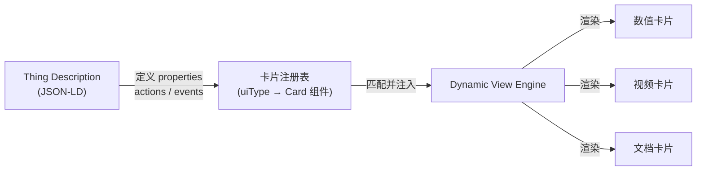
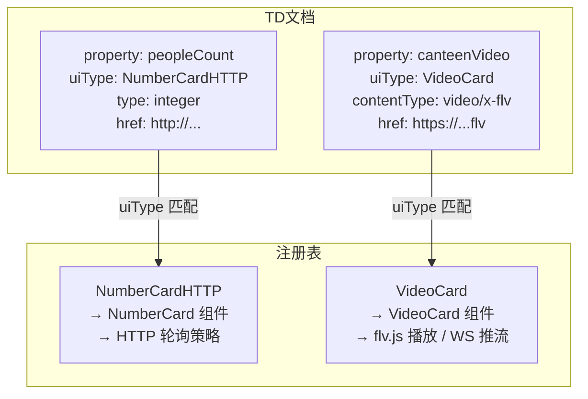
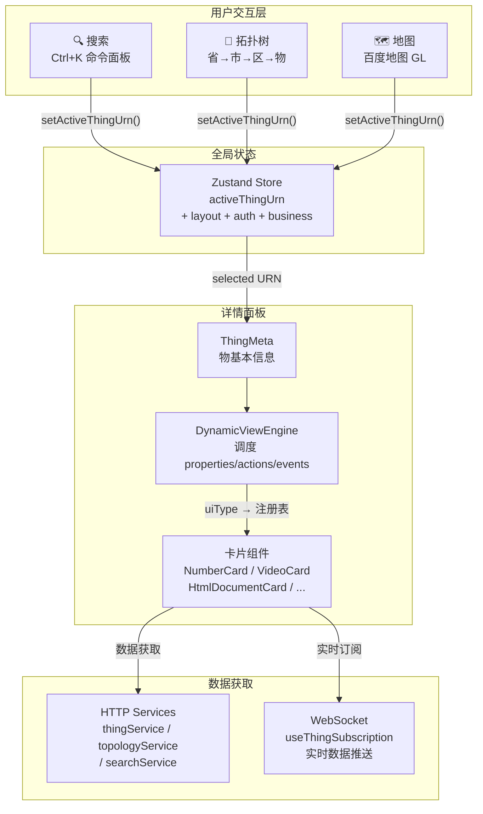
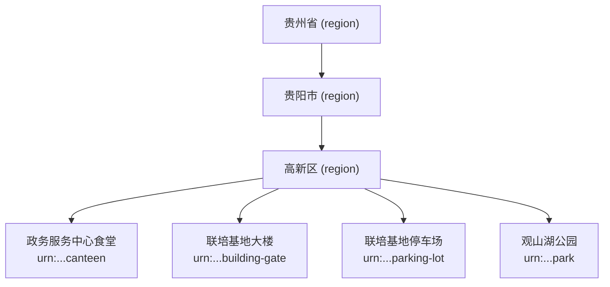
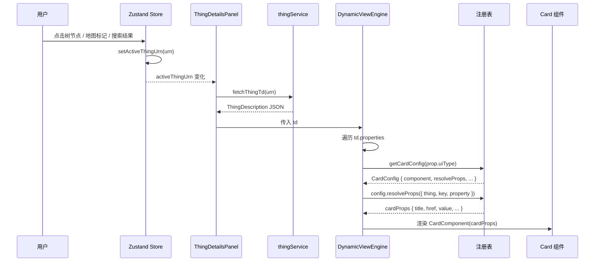
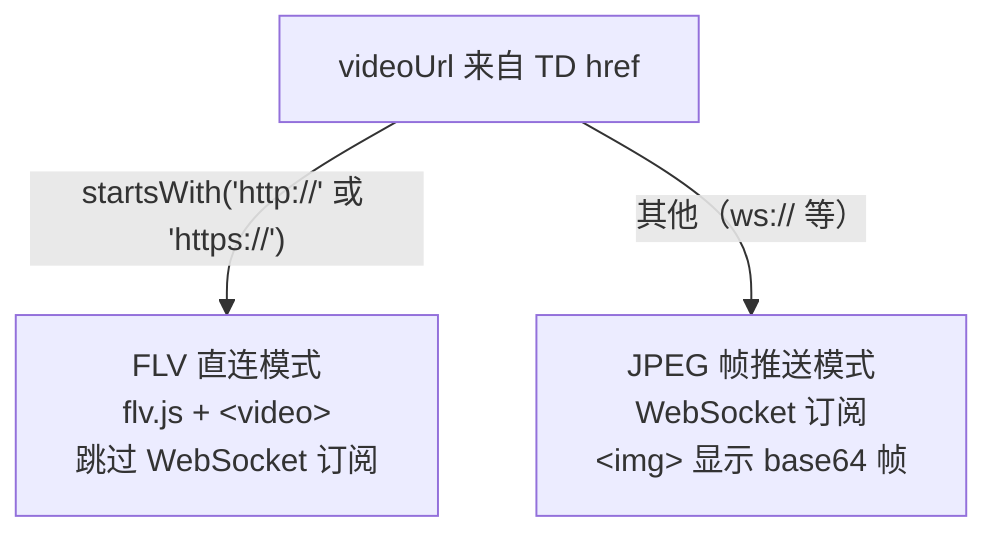
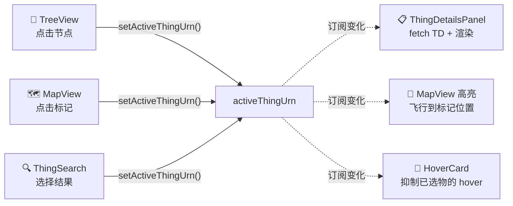

# ThingBrowser 设计指引

> 面向接手开发的同事 —— 说明设计思路、关键决策与逻辑框架，不涉及代码细节与文件结构。

---

## 1. 项目概述

**ThingBrowser（物浏览器）** 是一个物联网（IoT）设备与场所的可视化管理仪表盘。与传统设备管理后台不同，它的核心思路是：**以"物"（Thing）为中心**，将传感器、摄像头、门禁、场所等统一抽象为"物"，通过标准化描述驱动前端动态渲染。

三个核心交互入口：

| 入口 | 功能 |
|------|------|
| **拓扑树**（侧边栏） | 按地理层级（省→市→区）浏览物节点 |
| **地图视图** | 百度地图上可视化物的空间分布，hover 预览卡片，点击查看详情 |
| **全局搜索**（Ctrl+K） | 模糊搜索物名称或地址，直接定位 |

选中一个物后，**详情面板**动态渲染其功能卡片（数值、视频、文档、开关等），卡片类型由物的描述文档自动决定，而非硬编码。

---

## 2. 核心设计理念

### 2.1 为什么选择 W3C WoT Thing Description（TD）标准？

整个项目围绕一个关键设计决策展开：**物长什么样、有什么能力，不由前端代码决定，而由 TD 文档描述**。

[W3C Web of Things (WoT) Thing Description](https://www.w3.org/TR/wot-thing-description/) 是 W3C 发布的物联网设备描述标准。选择它的理由：

- **标准化语义**：每个物通过 `properties`（属性）、`actions`（动作）、`events`（事件）三元组描述其能力，这是 IoT 领域的通用语义模型
- **自描述性**：TD 文档包含物的元信息（名称、类型、位置、鉴权方式）和每个交互端点的完整 URL，前端无需硬编码任何接口路径
- **驱动式渲染**：前端读取 TD → 注册表匹配卡片组件 → 渲染。新增一个物不需要写一行前端代码，只需提供新的 TD JSON
- **可扩展**：通过 `@context` 引入 `platform` 命名空间，添加项目特有的字段（地址、经纬度、安全等级），而不破坏标准兼容性

### 2.2 数据驱动 UI，而非功能驱动 UI

传统做法是"需求说要显示一个温度计 → 写一个温度计组件"。这个项目的做法是：

> **TD 说这个 property 是 `integer` 类型 + `NumberCardHTTP` 样式 → 前端自动渲染数值卡片，并用 HTTP 轮询获取数据。**

这层抽象的关键收益：**新增一个物或一种数据形态时，改动局限在数据层（TD JSON + 注册表配置），UI 层自动适配。** 物模型的热插拔是这套架构的自然结果。

### 2.3 核心抽象层：`uiType` → 卡片注册表

TD 中每个 property/action/event 可带一个 `uiType` 字段（平台扩展）。这个字段是连接"数据描述"和"UI 呈现"的枢纽：

注册表每一项定义了：
- **`component`**：使用哪个 React 组件
- **`resolveProps`**：如何从 TD 片段提取组件 props（URL 构建、字段映射）
- **`dataSourceType`**：数据获取方式（`http`、`ws`、`static`）

---

## 3. 架构总览

关键架构原则：
- **单一选中源**：任何时候只有一个 `activeThingUrn`，所有组件通过 Zustand 读写它，避免了 props drilling 和多源同步问题
- **详情面板是被动渲染**：面板不关心是树、地图还是搜索触发了选择，只响应 `activeThingUrn` 的变化
- **服务层分离**：HTTP/WS 封装在 `services/` 下，业务组件不直接处理 URL 拼接和请求细节

---

## 4. TD 文档的角色（Backend 部分）

### 4.1 TD 文档是什么

TD（Thing Description）是每个"物"的自描述文档，存放在 `backend/things/TD/` 目录下（目前有 4 个：食堂、大楼门禁、停车场、公园）。它的角色是：

> **TD 文档 = 物的"说明书" + 数据端点的"通讯录"**

一份 TD 文档告诉前端：
- 这个物叫什么、在哪、是什么类型
- 它有哪些可读的属性（properties）、可触发的动作（actions）、可订阅的事件（events）
- 每个交互的完整 URL 是什么、数据格式是什么
- 前端应该用什么卡片样式展示

### 4.2 拓扑结构：物从哪来

`backend/things/topology.json` 定义了一棵地理层级树，叶子节点通过 `thingUrn` 指向 TD 文档：

> **注意**：当前 backend 其余部分（`server.js`、`mock-data/`、`search/`）是 Mock Server 模拟实现，不在本文档讨论范围。TD 文档和拓扑 JSON 是其中具有业务含义的部分。

### 4.3 Platform 扩展字段

项目在标准 WoT TD 之上通过 `platform:` 命名空间扩展了以下字段：

| 字段 | 含义 |
|------|------|
| `platform:address` | 物所在地址（中文层级地址） |
| `platform:geo` | 经纬度坐标，用于地图标注 |
| `platform:securityLevel` | 数据密级（L1-L4），已预留但当前未过滤 |
| `uiType` | 指定渲染卡片类型，是注册表匹配的 key |

---

## 5. 关键数据流

### 5.1 TD → 注册表 → 卡片渲染（主线）

这是项目最核心的数据流，从选中一个物到看到卡片的全过程：

### 5.2 数据获取：HTTP 轮询 vs WebSocket 推送

卡片组件对数据的获取有两种模式，由注册表中的 `dataSourceType` 决定：

| 模式 | 适用场景 | 实现方式 |
|------|---------|---------|
| **HTTP 轮询** | 数值类属性（人数、温度），`observable: true` 时自动定时拉取 | `useQuery` + `refetchInterval`（详情面板） / 轻量 `fetch()` 轮询（HoverCard） |
| **WebSocket 推送** | 实时视频帧、高频传感器 | `useThingSubscription` hook，基于共享 WS 连接订阅特定 key |
| **静态** | 开关、按钮等不需数据获取的交互组件 | 直接渲染，数据来自 TD 自身 |

**设计决策：为什么 HoverCard 没有复用 CardWrapper 的 react-query 方案？**

HoverCard 的生命周期是命令式的（鼠标移入 → 开始轮询，移出 → 立即停止），而 react-query 是声明式的（由 key 和 `enabled` 控制）。HoverCard 需要：
- 500ms 高频轮询（非 5s）
- AbortController 精确控制取消时机
- 不需要缓存和去重

因此 HoverCard 使用了独立的轻量轮询 hook（`useHttpPolling`），而详情面板继续使用 react-query 获得缓存和重试能力。

### 5.3 双模式视频播放

VideoCard 是唯一支持两种数据源的卡片，通过 URL 前缀自动切换：

这个设计的理由：萤石云等摄像头提供公开的 HTTP-FLV 直播地址，直接由浏览器端 flv.js 拉流比经过后端中转更简洁。而 WebSocket JPEG 模式则适用于内网摄像头帧推送场景。

---

## 6. 组件联动机制

### 6.1 以 `activeThingUrn` 为中心的发布-订阅

三个入口组件（树、地图、搜索）只负责**写入** `activeThingUrn`，详情面板和地图高亮只负责**响应**它的变化。这就是 Zustand 的发布-订阅模式：

### 6.2 地图联动细节

当选中的物不在当前地图视野内时（如从树中选中一个远处的物），`MapView` 的处理逻辑：
1. 检查该 URN 的 Marker 是否已在地图上 → 是则高亮 + 飞行
2. 否则调用 `fetchThingTd(urn)` 获取物的坐标 → `centerAndZoom()` 飞行到该位置 → 触发视野数据加载

HoverCard 对已选中的物会**抑制显示**（因为详情面板已经展示了完整信息），避免信息冗余。

---

## 7. 状态管理设计

### 7.1 Zustand Slices 划分

全局状态使用 Zustand 的 Slice 模式拆分为四个独立领域：

| Slice | 职责 | 是否持久化 |
|-------|------|-----------|
| **NavigationSlice** | `activeThingUrn`（当前选中的物）、`searchOpen`（搜索弹窗状态） | 否 |
| **LayoutSlice** | 侧边栏/地图/详情面板的显隐、详情面板位置（bottom/right） | ✅ 持久化 |
| **AuthSlice** | 用户信息和 token | ✅ 持久化 |
| **BusinessSlice** | 树节点的子节点缓存（`treeChildrenById`）、全局业务错误信息 | 否 |

持久化策略的选择理由：
- **持久化布局和认证**：刷新页面后用户不想重新展开面板或登录
- **不持久化选中状态**：刷新后自动回到初始状态更自然，避免 URL 与界面状态不一致
- **不持久化树缓存**：缓存数据量可能很大且容易过期，每次刷新重新加载更可靠

### 7.2 为什么不用 Context？

Zustand 相较于 React Context 的优势在这个项目中很明确：
- **避免 Provider 嵌套**：四个 Slice 如果各用 Context，嵌套层级会迅速增长
- **精准重渲染**：Zustand 的选择器（selector）确保组件只在关心的状态变化时重渲染 —— 例如 `MapView` 只订阅 `activeThingUrn`，不会因侧边栏显隐而重渲染
- **跨组件读写**：树、地图、搜索分布在完全不同的组件树分支中，Zustand 天然支持这种模式

---

## 8. 扩展指南

### 8.1 新增一个物

1. 在 `backend/things/TD/` 创建新的 TD JSON 文件，定义物的 `properties`、`actions`、`events`，每个交互描述需包含 `uiType` 和 `forms[0].href`
2. 在 `backend/things/topology.json` 的对应区域节点下添加 `{ "id": "xx", "title": "物名", "type": "thing", "thingUrn": "urn:platform:thing:xxx" }`
3. 如果物的属性引用了已有的 `uiType`（如 `NumberCardHTTP`、`VideoCard`），前端无需改动
4. 如果需要新的数据端点，确保 backend mock server（或未来的真实后端）支持对应的 `/proxy/things/:urn/properties/:key` 路由

### 8.2 新增一种卡片类型

1. 在 `DataCardTemplates.tsx` 中实现卡片组件（接收 title + 业务 props，处理 open/loading 等通用状态）
2. 在 `DataCardTemplates.registry.ts` 的 `COMPONENT_REGISTRY` 中添加注册项：
   - `uiType`：TD 文档中引用的标识符
   - `dataSourceType`：`"http"` | `"ws"` | `"static"`
   - `component`：上面实现的组件
   - `resolveProps`：从 TD 片段映射到组件 props 的函数
3. TD 文档中相应的 property/action/event 设置 `"uiType": "你的新类型"` 即可触发新卡片

**关键原则**：组件本身不应包含数据获取逻辑。数据获取由 `CardWrapper`（详情面板）或专用 hook（HoverCard）处理，组件只负责根据 props 渲染 UI 状态。

### 8.3 新增一种数据获取模式

当前支持 HTTP 轮询和 WebSocket 推送。如需新增（例如 SSE、MQTT）：

1. 在 `services/` 下实现对应的数据获取 hook/service
2. 在注册表中新增对应的 `CardConfig` 项，设置 `dataSourceType` 为新模式
3. 在 `CardWrapper` 中添加新模式的分支逻辑（仿照 `VideoCardWrapper` 对 FLV/JPEG 双模式的处理）

---

## 9. 关键设计决策速查

| 决策 | 选择 | 核心理由 |
|------|------|---------|
| 物模型标准 | W3C WoT TD | 标准化 + 自描述 + 驱动式渲染，新增物无需改前端 |
| UI 渲染策略 | `uiType` + 注册表 | 数据与 UI 解耦，避免硬编码 if-else |
| 全局状态 | Zustand + Slices | 轻量、选择器避免不必要渲染、跨分支组件通信自然 |
| 数据获取（详情） | react-query | 缓存、去重、窗口聚焦刷新，适合声明式场景 |
| 数据获取（HoverCard） | 自定义 hook + AbortController | 命令式生命周期、高频轮询、需即时取消 |
| 视频播放 | 双模式（FLV 直连 + WS JPEG） | 兼容公网摄像头直连和内网帧推送两种场景 |
| HoverCard 定位 | React Portal + `pointToPixel` | 相对地图容器定位，跟随地图平移/缩放 |
| 组件注册表分离 | `DataCardTemplates.tsx` + `.registry.ts` | 绕过 React Fast Refresh 的 HMR 限制 |

---

## 10. 相关文档

- `docs/addVideo.md` — 食堂实时画面功能变更的完整记录（TD 变更 + VideoCard 重构 + flv.js 集成）
- `docs/mapHoverCardPlan.md` — 地图 HoverCard 功能的详细设计计划（状态机、定位算法、动画方案）
- `README.md` — 项目快速运行指南
